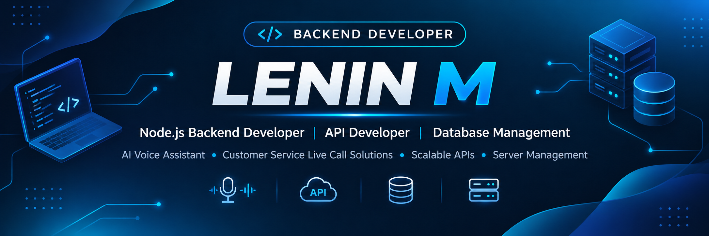

  

  # Hi, I'm Lenin M 👋

  **Node.js Backend Developer · API Engineer · Database Management**

  
  
  

  *Building reliable APIs, scalable backend systems, and AI-powered solutions.*

---

## 👨‍💻 About Me

Backend Developer with **3+ years of experience** building scalable backend applications, REST APIs, and database-driven solutions. I enjoy solving real-world problems through efficient backend architecture, third-party integrations, and production server management.

## 🛠️ Technical Stack

| Domain | Technologies |
| :--- | :--- |
| Backend |  |
| Databases |  |
| Infrastructure |  |
| Version Control |  |
| API & ORM |    |
| AI & Voice |    |
| Server Tools |  |

---

## 🚀 Featured Projects

<table>
<tr>
<td width="50%" valign="top">

### 🛍️ Offer360
**Hyperlocal Offers & Shopping Platform**

- Customer and vendor management
- AI-powered offer and product search
- Payment gateway integration
- Delivery service integration

`REST APIs` `AI Integration` `Payments`

</td>
<td width="50%" valign="top">

### 🪙 DigiGold
**Digital Gold & Silver Savings Platform**

- Monthly savings schemes
- Razorpay payment integration
- Admin and customer management

`Backend APIs` `Razorpay` `Database`

</td>
</tr>
<tr>
<td width="50%" valign="top">

### 📺 IPTV / OTT Platform
**Live TV & Streaming Backend**

- Channel and package management
- MSO and reseller management
- Streaming server integrations

`Streaming APIs` `Server Management`

</td>
<td width="50%" valign="top">

### 🏪 Pattaz
**Multi-Tenant E-commerce SaaS**

- Shop and customer order management
- Subdomain-based shop architecture
- Multi-tenant backend services

`SaaS` `Multi-Tenant` `REST APIs`

</td>
</tr>
<tr>
<td colspan="2" valign="top">

### 🎙️ AI Voice Assistant — Customer Service Live Calls
**Real-Time Conversational AI & Customer Support Automation**

- AI-powered live customer service calls
- Speech-to-text and text-to-speech integration
- Real-time conversational response handling
- Telephony API integration and call-flow management
- Automated customer query handling

`Node.js` `Voice AI` `STT` `TTS` `Telephony APIs`

</td>
</tr>
</table>

## ⚡ Core Competencies

| Domain | Expertise |
| :--- | :--- |
| Backend Engineering | REST APIs, business logic, scalable backend architecture |
| Database Management | Database design, query optimization, ORM |
| Integrations | Third-party APIs, payment gateways, delivery services |
| Conversational AI | Voice assistants, live call automation, AI integrations |
| Infrastructure | Linux, Nginx, production server management |
| Deployment | Production deployment, maintenance, troubleshooting |
| Documentation | Swagger and API documentation |

## 🌱 Currently Exploring

- Advanced Node.js and scalable backend architecture
- NestJS and GraphQL
- Real-time AI and voice integrations

---

## 🤝 Connect With Me

Thanks for visiting my GitHub profile. Explore my repositories to learn more about my work.

**Clean Code · Reliable APIs · Scalable Systems · AI-Powered Solutions**

*Building practical solutions through code.*

